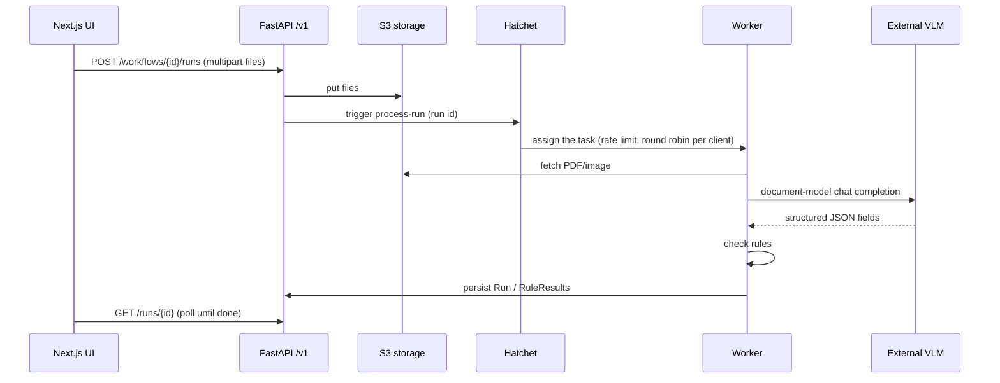

# Repody - architecture context

Single-page map for tech leads and new contributors. How-tos: [docs/README.md](./docs/README.md). Decisions: [docs/adr/](./docs/adr/).

## Names (read once)

| Name | Where | Meaning |
|------|--------|---------|
| **Repody** | Product, repo, npm package, Helm release | Public name everywhere |
| **repody** | Python package (`backend/src/repody/`, dist name) | Import path + `pip install -e backend` |
| **`AUDIT_*`** | Env vars | Settings prefix (kept for stable ops config) |
| **Next.js `app/`** | Repo root `app/` | App Router routes (thin pages) - not Python |
| **`repody.app`** | `backend/src/repody/app/` | Python application use cases (Workflow, Run, …) |

Default document extraction: NuExtract via OpenAI-compatible llama-server (`repody:vlm`).

## Domain glossary

| Term | Meaning |
|------|---------|
| **Workflow** | Configured audit template: documents, field schema, validation rules |
| **Run** | One execution of a workflow against uploaded files (test or production) |
| **Document model** | `repody:vlm` — NuExtract3 on an OpenAI-compatible llama-server ([docs/EXTRACTION.md](./docs/EXTRACTION.md)) |
| **Logic rule** | Typed conditions on extracted fields (`rules/`); passed, failed or skipped |
| **Audit** | A done run: its report, with an outcome of passed, warning or failed |
| **Lifecycle** | The states of a run, workflow or builder flow, and their one owner: [docs/LIFECYCLES.md](./docs/LIFECYCLES.md) |

## Request lifecycle



## Backend layers

```
backend/src/repody/
├── main.py · worker.py  FastAPI app; Hatchet worker (process-run workflow, maintenance cron)
├── api/               HTTP routes (workflows, runs, platform) and caller dependencies
├── app/               Use cases: workflows, runs, execute (worker), progress, maintenance,
│                      lifecycle (the only code that changes a run's status)
├── extraction/        NuExtract requests, page rendering, model client, field values
├── rules/             Typed conditions and their evaluation
├── schemas/           Pydantic models (API and stored workflow definition)
├── infra/             auth (Keycloak JWT, roles, API keys), queue (Hatchet client), models,
│                      db, storage (S3), observability (logs, errors)
└── settings.py        AUDIT_* settings
```

**Hot path:** `app/execute.py` `process_run`: claim (conditional UPDATE) -> extract each document -> check rules -> save the report ([ADR 009](./docs/adr/009-simple-backend.md)).

### Bounded contexts

| Context | Responsibility | Key modules |
|---------|----------------|-------------|
| **Workflow configuration** | Definition (documents + rules), deployment, API keys | `app/workflows.py`, `schemas/workflow.py` |
| **Run execution** | Start, queue, process, progress, upkeep | `app/runs.py`, `app/execute.py`, `app/progress.py`, `queue.py` |
| **Rules** | Typed conditions and their evaluation | `rules/` |

### Run pipeline

One Hatchet workflow, `process-run`, with one task (`process_run`). The API triggers it after the commit and keeps the Hatchet run id (`runs.task_run_id`, to cancel it); when Hatchet cannot take it, the run fails at once and the API answers 503. Hatchet enforces the timeouts (an hour to reach a worker, `AUDIT_RUN_TIMEOUT_MINUTES` to finish), the per-client rate limit and round robin, and calls the workflow's failure task when it gives up (a timeout, a lost worker), which fails the run. A Hatchet cron runs maintenance every minute: it purges runs past their retention and the playground's old workflows. [ADR 011](./docs/adr/011-hatchet.md). Every status change is a conditional UPDATE through `app/lifecycle.py`, so a duplicate delivery does nothing and a final run is never overwritten ([LIFECYCLES.md](./docs/LIFECYCLES.md)). Each run keeps its own copy of the workflow definition. Decision: [ADR 009](./docs/adr/009-simple-backend.md).

## Extraction

`extraction/pipeline.py` `extract` is the one entry point: NuExtract on the
llama-server (`extraction/client.py`). Model availability is `GET /v1/models` on the llama-server,
shown by `GET /v1/platform/config`.

## Inference

| Concern | Configuration |
|---------|---------------|
| Document extraction | `AUDIT_LLAMACPP_BASE_URL`, `AUDIT_LLAMACPP_SERVED_MODEL` |


## Frontend layout

Next.js 16 App Router at repo root:

- `app/` - thin pages
- `components/` - domain UI
- `lib/api/` - typed clients; RSC `serverFetch`, client islands via `/api/*` -> backend `/v1/*`

## Deploy modules

| Module | Kubernetes shape | Purpose |
|--------|------------------|---------|
| control | `repody-api` | Workflows, runs, uploads |
| worker | `repody-worker` | Hatchet worker: runs and the maintenance cron (scale by replicas) |
| edge | `repody-web` | Next.js UI |
| data plane | Postgres, Hatchet, object storage | Durable state; Hatchet queues the runs (Hatchet Lite on Postgres in Compose) |
| auth | External OIDC | Authentication |
| inference | External OpenAI-compatible | Not in the Repody chart |

Daily local: Compose ([docs/LOCAL.md](./docs/LOCAL.md)). Production: Helm ([docs/CLUSTER.md](./docs/CLUSTER.md)). Packaging: [ADR 004](./docs/adr/004-cloud-kubernetes-packaging.md) · [ADR 005](./docs/adr/005-kubernetes-only-external-inference.md).

| Lane | Command |
|------|---------|
| Run the product locally | `pnpm platform` |
| Develop from source | `pnpm platform dev` |
| Kubernetes production | [docs/CLUSTER.md](./docs/CLUSTER.md) |
| Release to client | `pnpm images:release` |

## Authorization

Keycloak realm roles -> `infra/auth.py` (`ROLE_PERMISSIONS`). Routes declare `require("workflow:write")` and similar. When `AUDIT_OIDC_ENABLED=false`, API uses a `platform_admin` dev principal. Users and role assignments are managed in the Keycloak admin console.

| Role | Typical access |
|------|----------------|
| `viewer` | Read workflows, runs and audits |
| `operator` | Viewer + write workflows, start runs, dashboard and platform config |
| `admin` | Operator + delete workflows |
| `platform_admin` | Admin + grant credits; sees every client |

Roles say what a user may do; their **account** says on what (`app/scope.py`). A Keycloak group `client-<name>` makes the user's client company their account: they see and change only its workflows and runs, and shared workflows (no account) read-only. Users outside any client group see everything. **Credits** (`app/credits.py`, `credit_entries`): every run is metered by pages sent to the model and, with `AUDIT_CREDITS_ENFORCED`, refused (402) when its account cannot pay. Setup and sizing: [deploy/ENV.md](deploy/ENV.md#credits).

## Tests

| Layer | Command |
|-------|---------|
| Backend unit/integration | `pnpm test:api` |
| Live stack | `pnpm test:live` (needs stack) |
| Playwright smoke | `pnpm test:e2e:smoke` |

Full command list: [docs/COMMANDS.md](./docs/COMMANDS.md). Engineering notes: [docs/DEVELOPMENT.md](./docs/DEVELOPMENT.md).

## Further reading

- [docs/README.md](./docs/README.md) - docs hub
- [docs/EXTRACTION.md](./docs/EXTRACTION.md) - document models
- [docs/LIFECYCLES.md](./docs/LIFECYCLES.md) - every state machine and its owner
- [docs/adr/](./docs/adr/README.md) - ADRs
