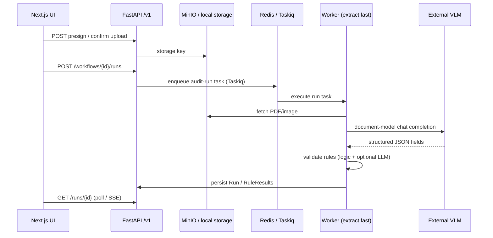

# Repody - architecture context

Single-page map for tech leads and new contributors. How-tos: [docs/README.md](./docs/README.md). Decisions: [docs/adr/](./docs/adr/).

Full functional + technical architecture dossier (FR): [docs/ARCHITECTURE.md](./docs/ARCHITECTURE.md).

## Names (read once)

| Name | Where | Meaning |
|------|--------|---------|
| **Repody** | Product, repo, npm package, Helm release | Public name everywhere |
| **repody** | Python package (`backend/src/repody/`, dist name) | Import path + `pip install -e backend` |
| **`AUDIT_*`** | Env vars | Settings prefix (kept for stable ops config) |
| **Next.js `app/`** | Repo root `app/` | App Router routes (thin pages) - not Python |
| **`repody.app`** | `backend/src/repody/app/` | Python application use cases (Workflow, Run, …) |

Default document extraction: NuExtract via OpenAI-compatible llama-server (`repody:vlm`).

## Domain glossary

| Term | Meaning |
|------|---------|
| **Workflow** | Configured audit template: documents, field schema, validation rules |
| **Run** | One execution of a workflow against uploaded files (test or production) |
| **Document model** | Catalog adapter (`repody:vlm`, `repody:vlm:cloud`, `paddleocr:qwen`, `glm:qwen` - [docs/EXTRACTION.md](./docs/EXTRACTION.md)). Markdown-only OCR (`paddleocr:v6`, `glm:ocr`) is an **internal stage**, not a UI catalog option |
| **Logic rule** | Deterministic check via `simpleeval` on extracted fields |
| **LLM rule** | Natural-language rule via a separate text model |
| **Worker pool `extract`** | Taskiq worker for document-model extraction |
| **Worker pool `fast`** | Taskiq worker for logic-only / no-file runs |
| **`AUDIT_DEFAULT_DOCUMENT_MODEL_ID`** | Default catalog id (`repody:vlm`) |

## Request lifecycle

Production architecture for executives (ArchiMate + logos): [docs/diagrams/architecture-enterprise.html](./docs/diagrams/architecture-enterprise.html). Engineers: [docs/diagrams/architecture.mmd](./docs/diagrams/architecture.mmd).



## Backend layers

```
backend/src/repody/
├── api/                 HTTP routers → app use cases
├── app/                 Application use cases (run, workflow, operator, …)
├── agents/idp/          contracts · compose · run · adapters/
├── runtime/             contracts · recipe · pools · run status
├── extraction/          pipeline · nuextract · paddleocr · glm · render
├── inference/           OpenAI-compat clients
├── rules/               Logic + LLM evaluators
├── catalog/             Document-model registry + probes
├── taskiq/              Worker entrypoint + async tasks
├── infra/               db · storage · auth · observability
├── schemas/             HTTP Pydantic DTOs
└── settings/            AUDIT_* settings
```

**Hot path:** `process_run` -> `execute_platform_run`(IDP) -> `compose_idp` -> `complete_run`.

### Bounded contexts

| Context | Responsibility | Key modules |
|---------|----------------|-------------|
| **Workflow configuration** | Templates, rules, deployment | `app/workflow/` |
| **Audit execution** | Claim/complete, queue, worker | `app/run/`, `taskiq/` |
| **IDP agent** | Extract + validate for a claimed Run | `agents/idp/` |
| **Platform / catalog** | Recipe, envelopes, registry, operator | `runtime/`, `catalog/`, `app/operator/` |

### Platform agents

**IDP** under `agents/idp/` is the only agent. Capacity pools: `extract` / `fast`. Decisions: [ADR 006](./docs/adr/006-three-agent-functional-idp.md) · [ADR 007](./docs/adr/007-staged-agent-queues-taskiq.md).

Domain events (`RunStarted`, `RunCompleted`, `RunFailed`) drive queue refresh and SSE. `RunStatus` lives in `runtime/run/status.py`. Lifecycle: `app/run/lifecycle.py` · `commands.py` · `persistence.py`. Worker entry: `app/run/processor.py`.

## Three registries (do not merge)

| Module | Selects | Example ids |
|--------|---------|-------------|
| `extraction/pipeline.py` | Extractor callable | `stub`, `pipeline` (`AUDIT_EXTRACTOR`) |
| `catalog/registry.py` | Document model catalog | `repody:vlm`, `paddleocr:qwen`, `glm:qwen` |
| `catalog/probes.py` + `api.py` | Live runtime probes | `/models/catalog`, healthz |

## Inference

| Concern | Configuration |
|---------|---------------|
| Document extraction | `AUDIT_INFERENCE_MODE=llamacpp`, `AUDIT_LLAMACPP_BASE_URL`, `AUDIT_LLAMACPP_SERVED_MODEL` |
| LLM rule validation | `get_chat()` when `AUDIT_LLM_VALIDATION_ENABLED=true` |

Separate models/endpoints for extraction vs LLM rules. Add models in `catalog/registry.py`.

## Frontend layout

Next.js 16 App Router at repo root:

- `app/` - thin pages
- `components/` - domain UI
- `lib/api/` - typed clients; RSC `serverFetch`, client islands via `/api/*` -> backend `/v1/*`

## Deploy modules

| Module | Kubernetes shape | Purpose |
|--------|------------------|---------|
| control | `repody-api` | Workflows, runs, uploads, dispatch |
| workers | `repody-worker-extract`, `repody-worker-fast` | IDP pools |
| edge | `repody-web` | Next.js UI |
| data plane | Postgres, Redis, object storage | Durable state + Taskiq broker |
| auth | External OIDC | Authentication |
| inference | External OpenAI-compatible | Not in the Repody chart |

Daily local: Compose ([docs/LOCAL.md](./docs/LOCAL.md)). Production: Helm ([docs/CLUSTER.md](./docs/CLUSTER.md)). Packaging: [ADR 004](./docs/adr/004-cloud-kubernetes-packaging.md) · [ADR 005](./docs/adr/005-kubernetes-only-external-inference.md).

| Lane | Command |
|------|---------|
| App development | `pnpm platform` / `pnpm dev:all` |
| Source contribute | `pnpm dev:src:all` |
| OpenShift production | [docs/CLUSTER.md](./docs/CLUSTER.md) |
| Release to client | `pnpm images:release` |

## Authorization (Casbin)

JWT roles -> `auth/rbac_policy.csv`. Routers use `require_permission(resource, action)`. When `AUDIT_OIDC_ENABLED=false`, API uses a `platform_admin` dev principal.

| Role | Typical access |
|------|----------------|
| `viewer` | Read workflows, runs, audits, models, rules |
| `operator` | Viewer + write workflows, execute runs, metrics, operator tools |
| `admin` | Operator + settings, diagnostics, users |

## Tests

| Layer | Command |
|-------|---------|
| Backend unit/integration | `pnpm test:api` |
| Live stack | `pnpm test:live` (needs stack) |
| Playwright smoke | `pnpm test:e2e:smoke` |

Full command list: [docs/COMMANDS.md](./docs/COMMANDS.md). Engineering notes: [docs/DEVELOPMENT.md](./docs/DEVELOPMENT.md).

## Further reading

- [docs/README.md](./docs/README.md) - docs hub
- [docs/EXTRACTION.md](./docs/EXTRACTION.md) - document models
- [docs/adr/](./docs/adr/README.md) - ADRs
