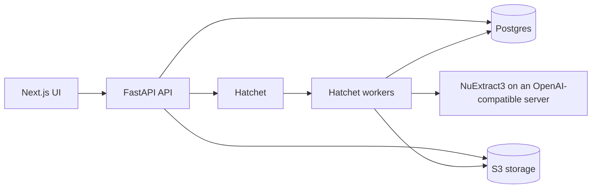

# Repody

Open-source document audit platform. Repody takes invoices, contracts and other documents,
extracts their fields with a vision-language model (NuExtract3), checks business rules across
them, and gives each run a report: passed, needs review, or failed.

[](https://github.com/MehdiGououiad/repody/actions/workflows/ci.yml)
[](LICENSE)

## Architecture



The model runs outside Repody: vLLM on Modal for the hosted demo, llama-server on a laptop, or
any OpenAI-compatible endpoint. Architecture map: [CONTEXT.md](./CONTEXT.md).

## Run it on a laptop

You need Docker Desktop, Node 26, Bun 1.4.4 and, for the model, llama-server with the NuExtract3
GGUF files (or a remote endpoint). Full guide: [docs/LOCAL.md](./docs/LOCAL.md).

```bash
git clone https://github.com/MehdiGououiad/repody.git
cd repody
npm install --global bun@1.4.4
bun install
bun run platform setup    # once: env files, then build the images from this checkout
bun run platform          # start everything, the model included
```

Open http://localhost:3000 (use `localhost`, not `127.0.0.1`) and sign in as
`operator@repody.local` / `repody-dev`. Stop with `bun run platform stop`.

## Documentation

| Need                                      | Read                                           |
| ----------------------------------------- | ---------------------------------------------- |
| Every guide, by goal                      | [docs/README.md](./docs/README.md)             |
| Architecture, glossary, backend layers    | [CONTEXT.md](./CONTEXT.md)                     |
| Every command                             | [docs/COMMANDS.md](./docs/COMMANDS.md)         |
| The hosted demo (VPS, staging, releasing) | [deploy/vps/README.md](./deploy/vps/README.md) |
| Configuration (`AUDIT_*`)                 | [deploy/ENV.md](./deploy/ENV.md)               |
| Security reports                          | [SECURITY.md](./SECURITY.md)                   |

## Stack

- Frontend: Next.js 16, React 19, ui-sdk, Tailwind, Bun
- Backend: Python 3.14, FastAPI, SQLAlchemy 2, Alembic, Pydantic v2
- Runs: [Hatchet](https://hatchet.run) (queue, timeouts, retries, per-client limits, cron)
- Data: Postgres 18, S3-compatible storage (SeaweedFS), Keycloak for sign-in

## License

[Apache License 2.0](LICENSE)
