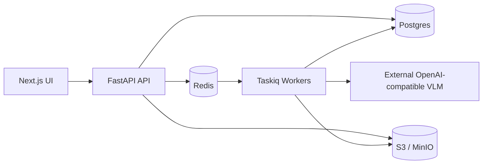

# Repody

Open-source document audit platform for invoices and contracts. Repody uploads
documents, extracts structured fields with an external vision-language model,
validates business rules, and runs async workflows through Taskiq workers.

[](https://github.com/MehdiGououiad/repody/actions/workflows/ci.yml)
[](LICENSE)

## Architecture



Production inference is external. Point Repody at llama-server, vLLM, or a managed OpenAI-compatible endpoint.

## Two laptop paths

| Who | What | Start |
|-----|------|--------|
| **Mac clients (no source)** | Zip + Hub images + host NuExtract | [docs/LOCAL.md - Mac runtime](./docs/LOCAL.md#mac-runtime-no-source) · pack with `pnpm client:pack:mac` |
| **Vendors / contributors (git)** | Full repo + `pnpm platform` | Below · [docs/LOCAL.md](./docs/LOCAL.md) |

### Git path (Windows · macOS · Linux)

Prerequisites: Docker Desktop, Node 24.x, Corepack pnpm 12.5.1, `llama-server` on PATH
(`winget install ggml.llamacpp` / `brew install llama.cpp`).

```bash
git clone https://github.com/MehdiGououiad/repody.git
cd repody
corepack enable
pnpm install
pnpm doctor
pnpm platform setup    # once: env files + build the images
# edit deploy/llamacpp/paths.local.env with NuExtract GGUF paths
pnpm platform          # start API/UI/workers + host NuExtract (repody:vlm)
pnpm platform status
```

Images: Docker Hub `mehdigououiad/repody-*` (multi-arch).  
Sign in: http://localhost:3000 · `operator@repody.local` / `repody-dev` (use **localhost**, not `127.0.0.1`).

Daily: `pnpm platform` · stop: `pnpm platform stop` · commands: [docs/COMMANDS.md](./docs/COMMANDS.md)

### OpenShift / Kubernetes

[docs/CLUSTER.md](./docs/CLUSTER.md) · release: `pnpm images:release`

## Documentation

**Hub:** [docs/README.md](./docs/README.md)

| Need | Read |
|------|------|
| Laptop | [docs/LOCAL.md](./docs/LOCAL.md) |
| Commands | [docs/COMMANDS.md](./docs/COMMANDS.md) |
| Cluster | [docs/CLUSTER.md](./docs/CLUSTER.md) |
| Architecture | [CONTEXT.md](./CONTEXT.md) |
| Extraction | [docs/EXTRACTION.md](./docs/EXTRACTION.md) |
| Code quality | [docs/CODE-QUALITY.md](./docs/CODE-QUALITY.md) |

## Stack

- Frontend: Next.js 16, React 19, Tailwind
- Backend: FastAPI, SQLAlchemy 2, Alembic, Pydantic v2
- Jobs: Taskiq over Redis Streams
- Local: Docker Compose, images built from the checkout (`pnpm platform`)
- Storage: MinIO or S3-compatible object storage

## License

[Apache License 2.0](LICENSE)
