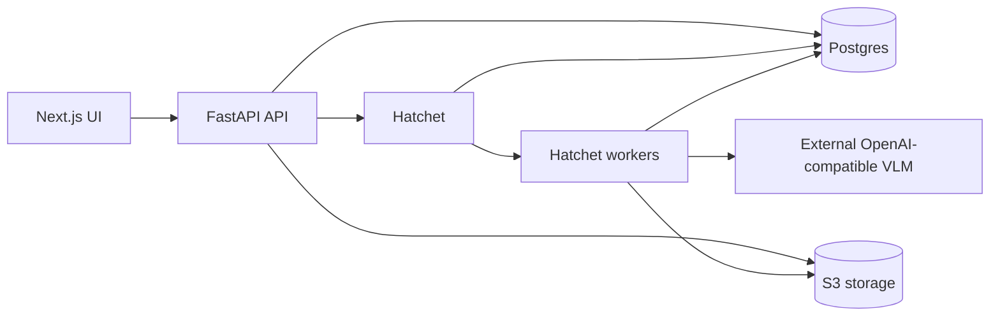

# Repody

Open-source document audit platform for invoices and contracts. Repody uploads
documents, extracts structured fields with an external vision-language model,
validates business rules, and runs async workflows on Hatchet workers.

[](https://github.com/MehdiGououiad/repody/actions/workflows/ci.yml)
[](LICENSE)

## Architecture



Production inference is external. Point Repody at llama-server, vLLM, or a managed OpenAI-compatible endpoint.

## Two laptop paths

| Who                              | What                           | Start                                    |
| -------------------------------- | ------------------------------ | ---------------------------------------- |
| **Vendors / contributors (git)** | Full repo + `bun run platform` | Below · [docs/LOCAL.md](./docs/LOCAL.md) |

### Git path (Windows · Linux)

Prerequisites: Docker Desktop, Node 26 (LTS), Bun 1.4.4 (`npm install --global bun@1.4.4`),
`llama-server` on PATH (`winget install ggml.llamacpp`).

```bash
git clone https://github.com/MehdiGououiad/repody.git
cd repody
npm install --global bun@1.4.4
bun install
bun run doctor
bun run platform setup    # once: env files + build the images
# edit deploy/llamacpp/paths.local.env with NuExtract GGUF paths
bun run platform          # start API/UI/workers + host NuExtract (repody:vlm)
bun run platform status
```

Images: Docker Hub `mehdigououiad/repody-*` (multi-arch).  
Sign in: http://localhost:3000 · `operator@repody.local` / `repody-dev` (use **localhost**, not `127.0.0.1`).

Daily: `bun run platform` · stop: `bun run platform stop` · commands: [docs/COMMANDS.md](./docs/COMMANDS.md)

### OpenShift / Kubernetes

[docs/CLUSTER.md](./docs/CLUSTER.md) · release: `bun run images:release`

## Documentation

**Hub:** [docs/README.md](./docs/README.md)

| Need         | Read                                           |
| ------------ | ---------------------------------------------- |
| Laptop       | [docs/LOCAL.md](./docs/LOCAL.md)               |
| Commands     | [docs/COMMANDS.md](./docs/COMMANDS.md)         |
| Cluster      | [docs/CLUSTER.md](./docs/CLUSTER.md)           |
| Architecture | [CONTEXT.md](./CONTEXT.md)                     |
| Extraction   | [docs/EXTRACTION.md](./docs/EXTRACTION.md)     |
| Code quality | [docs/CODE-QUALITY.md](./docs/CODE-QUALITY.md) |

## Stack

- Frontend: Next.js 16, React 19, Tailwind
- Backend: FastAPI, SQLAlchemy 2, Alembic, Pydantic v2
- Jobs: [Hatchet](https://hatchet.run) (Hatchet Lite on Postgres in Compose): queue, timeouts, per-client limits, cron
- Local: Docker Compose, images built from the checkout (`bun run platform`)
- Storage: any S3-compatible object storage (SeaweedFS in Compose)

## License

[Apache License 2.0](LICENSE)
