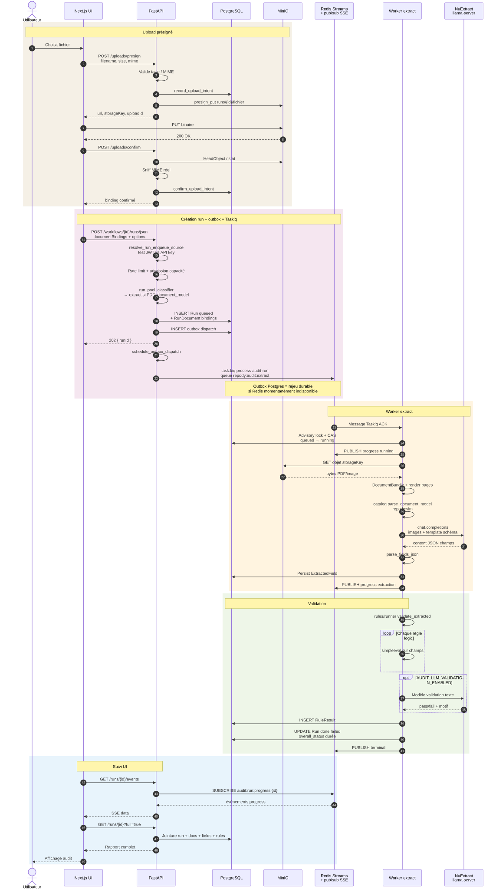
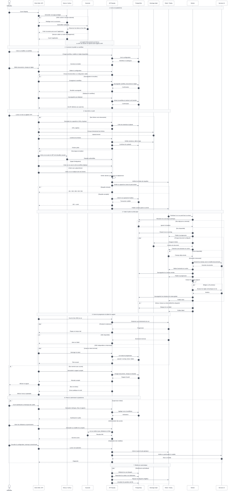

# Dossier d'architecture fonctionnelle et technique — Repody

**Produit :** Repody — plateforme d'audit documentaire (IDP : *Intelligent Document Processing*).
**Objet du document :** décrire l'ensemble des fonctionnalités de la solution, expliquer chaque composant, et fournir les vues d'architecture (séquence et technique).
**Public visé :** architectes d'entreprise, direction technique, équipes d'intégration client.

Documents liés : [CONTEXT.md](../CONTEXT.md) (carte produit) · [LOCAL.md](./LOCAL.md) (poste de travail) · [CLUSTER.md](./CLUSTER.md) (production) · [EXTRACTION.md](./EXTRACTION.md) (modèles documentaires) · [adr/](./adr/README.md) (décisions d'architecture).

---

## Sommaire

1. [Périmètre et principes directeurs](#1-périmètre-et-principes-directeurs)
2. [Architecture fonctionnelle](#2-architecture-fonctionnelle)
3. [Architecture applicative — les composants](#3-architecture-applicative-les-composants)
4. [Architecture technique](#4-architecture-technique)
5. [Diagrammes de séquence](#5-diagrammes-de-séquence)
6. [Diagrammes d'architecture technique](#6-diagrammes-darchitecture-technique)
7. [Annexes](#7-annexes)

---

## 1. Périmètre et principes directeurs

### 1.1 Proposition de valeur

Repody permet à une organisation de **configurer un audit documentaire sans écrire de code**, puis de l'exécuter à grande échelle :

1. L'utilisateur métier décrit les documents attendus (facture, contrat…) et les **champs** à extraire.
2. Il définit des **règles de contrôle** (déterministes ou en langage naturel).
3. Il **déploie** le workflow, qui devient une API consommable par les systèmes amont.
4. Chaque exécution (*run*) produit un **rapport d'audit** : champs extraits, contrôles passés/échoués, traçabilité.

### 1.2 Principes d'architecture

| Principe | Mise en œuvre |
|---|---|
| **Séparation synchrone / asynchrone** | L'API répond en `202` et délègue le traitement lourd à des workers Taskiq. |
| **Inférence externalisée** | Aucun poids de modèle n'est embarqué dans les images applicatives ; le moteur d'IA est un endpoint OpenAI-compatible ([ADR 005](./adr/005-kubernetes-only-external-inference.md)). |
| **Fiabilité de la mise en file** | Motif *outbox* en base : le job n'est publié qu'après commit de la transaction. |
| **Modularité de déploiement** | Quatre modules déployables indépendamment : edge, control, workers, data ([ADR 003](./adr/003-modular-platform-modules.md)). |
| **Portabilité** | Même chaîne applicative en local (Compose) et en production (Helm) ; seul le *placement* change ([ADR 004](./adr/004-cloud-kubernetes-packaging.md)). |
| **Sécurité par défaut** | OIDC obligatoire en production, autorisation Casbin sur chaque route, secrets hors Git. |

### 1.3 Ce qui n'est pas dans le périmètre applicatif

- L'**hébergement des modèles d'inférence** (fourni par le client ou un service managé).
- Le **fournisseur d'identité** en production (IdP du client).
- La **politique réseau** et l'egress du cluster (propriété de la plateforme cliente).

---

## 2. Architecture fonctionnelle

### 2.1 Glossaire métier

| Terme | Définition |
|---|---|
| **Workflow** | Modèle d'audit configuré : liste de documents, schéma de champs, règles de validation. |
| **Document** | Un type de pièce attendu dans le workflow (position, mode d'extraction, modèle documentaire). |
| **Champ de schéma** | Donnée à extraire (nom, description, type NuExtract, configuration). |
| **Run** | Une exécution du workflow sur des fichiers déposés (source `test` depuis l'UI, `api` depuis une intégration). |
| **Modèle documentaire** | Adaptateur du catalogue qui transforme un document en JSON structuré (`repody:vlm`, `paddleocr:qwen`…). |
| **Règle logic** | Contrôle déterministe évalué par `simpleeval` sur les champs extraits. |
| **Règle LLM** | Contrôle exprimé en langage naturel, évalué par un modèle de texte. |
| **Audit** | Vue métier d'un run terminé : rapport consultable et exportable. |
| **Pool `extract` / `fast`** | Files de traitement séparées : documents (coûteux) vs contrôles seuls (léger). |

### 2.2 Personas et habilitations

Quatre rôles applicatifs, portés par les claims du JWT et appliqués par Casbin (`infra/auth/rbac_policy.csv`).

| Rôle | Périmètre fonctionnel |
|---|---|
| **`viewer`** | Consultation : workflows, runs, audits, catalogue de modèles, bibliothèque de règles. |
| **`operator`** | Viewer + création/modification de workflows, exécution de runs, uploads, métriques, console opérateur, diagnostics. |
| **`admin`** | Operator + écriture des réglages et gestion des utilisateurs. |
| **`platform_admin`** | Accès total (`*, *`). Principal utilisé en mode développement lorsque l'OIDC est désactivé. |

La matrice complète figure en [annexe 7.3](#73-matrice-dhabilitations-casbin).

### 2.3 Catalogue des capacités fonctionnelles

#### A. Conception de workflows

| Capacité | Description |
|---|---|
| Création / édition guidée | Assistant en trois étapes : documents → règles → test et déploiement. |
| Multi-documents | Un workflow peut exiger plusieurs pièces, ordonnées par position. |
| Schéma de champs | Définition nom, description, type NuExtract, configuration avancée ; **suggestion automatique de type**. |
| Import de template | Import d'un template JSON NuExtract existant pour amorcer le schéma. |
| Instructions d'extraction | Consignes libres transmises au modèle pour un document donné. |
| Choix du modèle documentaire | Sélection dans le catalogue ; option **automode PDF natif** (`nativePdfAuto`). |
| Brouillon et sauvegarde auto | Le workflow reste en `draft` tant qu'il n'est pas déployé. |
| Déploiement | Passage en `active` et génération d'une **clé API** affichée une seule fois. |
| Suppression / archivage | Unitaire ou en masse depuis la liste. |

#### B. Règles de contrôle

| Capacité | Description |
|---|---|
| Règles *logic* | Expressions déterministes (`simpleeval`) avec coercition de dates et montants. |
| Agrégats tabulaires | Fonctions `sum_rows`, `count_rows_where`, etc. pour les champs de type tableau. |
| Constructeur de conditions | Interface de composition des opérandes, opérateurs et valeurs littérales. |
| Portées | Contrôle intra-document ou transverse (*cross-document*). |
| Sévérité | Qualification du niveau de gravité par règle. |
| Règles *LLM* | Prompt en langage naturel avec référencement des champs (`@field`), évalué par lot. |
| Bibliothèque de règles | Catalogue de modèles de règles réutilisables. |
| Validation en amont | Vérification syntaxique via l'API avant enregistrement. |

#### C. Ingestion documentaire

| Capacité | Description |
|---|---|
| Upload présigné | L'UI obtient une URL signée et téléverse **directement** vers le stockage objet. |
| Upload via API | Mode tampon lorsque le présigné n'est pas disponible (stockage local). |
| Multipart | Endpoint de repli acceptant les fichiers dans la requête de run. |
| Contrôles d'admission | Vérification du type MIME réel et de la taille, confirmation via `HeadObject`. |
| Capacités exposées | L'UI interroge `/v1/uploads/capabilities` pour adapter le mode et les limites. |

#### D. Exécution et suivi

| Capacité | Description |
|---|---|
| Test depuis le builder | Exécution avec le brouillon courant, sans déployer. |
| Dry-run | Extraction et règles sur une charge utile de test. |
| Exécution API | Déclenchement par un système tiers avec la clé du workflow déployé. |
| Classification de pool | Routage automatique vers `extract` (documents) ou `fast` (logique seule). |
| Contrôle de charge | Limitation de débit et plafonds d'admission sur la file. |
| Progression temps réel | Flux **SSE** : mise en file, extraction, validation, statut terminal. |
| Position dans la file | Restituée en parallèle du flux SSE. |
| Repli par polling | Si le SSE est indisponible, l'UI bascule sur l'interrogation périodique. |
| Reprise automatique | Détection des runs bloqués et rejeu des dispatchs non distribués. |

#### E. Restitution et rapports

| Capacité | Description |
|---|---|
| Liste des audits | Recherche et filtrage par statut. |
| Rapport détaillé | Champs extraits avec **indice de confiance**, résultats de règles, métadonnées de durée. |
| Export CSV | Export global des audits et export du rapport unitaire. |
| Impression | Mise en page dédiée à l'impression du rapport. |
| Localisation du rapport | Bascule de langue au niveau du rapport (EN/FR). |
| Traçabilité brute | Le JSON structuré du modèle est conservé verbatim dans `extraction_meta.rawText`. |

#### F. Pilotage

| Capacité | Description |
|---|---|
| Tableau de bord | Indicateurs clés, courbes de performance, répartition des violations. |
| Santé plateforme | Bandeau d'état et alertes, badge de file (en attente / en cours). |
| Audits récents | Accès direct aux dernières exécutions et aux échecs. |
| Synthèse workflows | Volumétrie et statut par workflow. |
| Onboarding | Panneau de démarrage pour les nouveaux environnements. |

#### G. Administration et exploitation

| Capacité | Description |
|---|---|
| Gestion des utilisateurs | Liste, invitation, modification des rôles et du statut (via l'API d'administration Keycloak). |
| Matrice des permissions | Visualisation des rôles et de leurs droits effectifs. |
| Profil courant | `/v1/iam/me` : principal et permissions effectives. |
| Console opérateur | Inventaire des modèles, **warmup**, diagnostics. |
| Benchmarks | Lancement de campagnes, suivi des jobs, rapports et artefacts (JSON, CSV, HTML). |
| Configuration runtime | Consultation des paramètres de modèles et de la configuration plateforme. |
| Diagnostics | Vérification du modèle documentaire, avec inférence réelle optionnelle. |

#### H. Transverse

Palette de commandes (`⌘K`), bascule de thème clair/sombre, internationalisation EN/FR, indicateur de disponibilité de l'API.

### 2.4 Parcours nominal

```
Concevoir ──► Déployer ──► Intégrer ──► Exécuter ──► Contrôler ──► Restituer
(builder)    (clé API)    (systèmes)   (run async)  (règles)     (rapport)
```

---

## 3. Architecture applicative — les composants

### 3.1 Vue d'ensemble

| # | Composant | Technologie | Responsabilité |
|---|---|---|---|
| 1 | **Web UI** | Next.js 16 · React 19 · Auth.js | Écrans métier, session OIDC, proxy applicatif vers l'API. |
| 2 | **API** | FastAPI (`repody-api`) | Plan de contrôle : workflows, uploads, runs, rapports, IAM, opérateur. |
| 3 | **Autorisation** | Casbin | Décision d'accès `(ressource, action)` sur chaque route. |
| 4 | **Bus de jobs / événements** | Redis Streams + pub/sub | Transport Taskiq et diffusion de la progression. |
| 5 | **Workers** | Taskiq (pools `extract`, `fast`) | Exécution asynchrone des runs. |
| 6 | **Agent IDP** | Python (`agents/idp/`) | Orchestration extraction → validation → persistance. |
| 7 | **Pipeline d'extraction** | Python (`extraction/`) | Rendu, appel modèle, projection des champs, cache. |
| 8 | **Moteur de règles** | `simpleeval` + LLM | Évaluation des contrôles déterministes et sémantiques. |
| 9 | **Base de données** | PostgreSQL | Source de vérité (workflows, runs, champs, résultats, outbox). |
| 10 | **Stockage objet** | MinIO / S3 | Fichiers déposés (`audit-documents`). |
| 11 | **Identité** | OIDC (Keycloak ou IdP client) | Authentification, rôles, JWKS. |
| 12 | **Inférence** | Endpoint OpenAI-compatible | Extraction documentaire et règles LLM. |

### 3.2 Web UI (`app/`, `components/`, `lib/`)

**Rôle :** unique point d'entrée humain.

- **Routes** : `/dashboard`, `/workflows`, `/workflows/new`, `/workflows/[id]/edit`, `/audits`, `/audits/[id]`, `/users`, `/settings`, `/login`, `/unauthorized`.
- **Session** : Auth.js v5 avec provider Keycloak ; rafraîchissement du token géré dans le callback JWT.
- **Proxy applicatif** (`proxy.ts`) : protège les pages non publiques et **injecte l'en-tête `Authorization: Bearer`** sur les appels `/api/v1/*`. Exception : si un appelant fournit déjà une clé de workflow, l'en-tête est préservé.
- **Accès API** : les composants serveur (RSC) appellent directement le backend via `INTERNAL_API_URL` ; le navigateur passe par le route handler `app/api/v1/[...path]/route.ts`.
- **Temps réel** : `lib/api/run-events.ts` ouvre le flux SSE, `lib/api/run-poll.ts` orchestre SSE + polling de position, avec repli complet en polling.

### 3.3 API (`backend/src/repody/api/`)

Treize modules de routes exposés sous le préfixe `/v1`.

| Module | Domaine fonctionnel |
|---|---|
| `health.py` | Liveness (`/healthz/live`) et readiness (`/healthz`, dépendances incluses). |
| `workflows.py` | CRUD, déploiement, validation de règles, dry-run. |
| `runs.py` | Création de runs (JSON et multipart), statut, détail, **flux SSE**. |
| `uploads.py` | Capacités, présigné, confirmation, upload direct. |
| `audits.py` | Liste et détail des runs terminés. |
| `dashboard.py`, `metrics.py` | Agrégats de pilotage. |
| `rules_library.py` | Bibliothèque de modèles de règles. |
| `config.py` | Configuration plateforme, catalogue de modèles, suggestion de type, diagnostics. |
| `operator.py` | Jobs opérateur : statut, warmup, benchmarks, artefacts. |
| `iam.py` | Profil courant, catalogue de rôles, gestion des utilisateurs. |

L'API n'exécute **jamais** l'extraction : elle valide, persiste, met en file, puis répond.

### 3.4 Couche applicative (`backend/src/repody/app/`)

| Module | Responsabilité |
|---|---|
| `workflow/` | Service, persistance de l'agrégat (documents + règles), validation, déploiement et clés API, statistiques. |
| `run/` | Admission et mise en file (`enqueue`), outbox (`dispatch_outbox`), dispatch Taskiq, traitement worker (`processor`), cycle de vie (`lifecycle`, `commands`), classification de pool, instantané de configuration (`snapshot`), progression et SSE. |
| `uploads/` | Intentions de dépôt, validation MIME et taille, association aux emplacements documentaires. |
| `audit/` | Requêtes de restitution des runs terminés. |
| `operator/` | Jobs de warmup et de benchmark, obtention de tokens. |
| `queue/`, `ops/` | Position de file, rafraîchissement, maintenance (runs bloqués, rejeu outbox). |

### 3.5 Runtime et agent IDP

**Runtime** (`runtime/`) : `resolve_recipe` détermine les agents actifs (IDP par défaut) ; `execute_platform_run` délègue l'étape à l'agent. `pools.py` maintient la correspondance pool ↔ agent. `RunStatus` (`queued`, `running`, `done`, `failed`) est défini dans `runtime/run/status.py`.

**Agent IDP** (`agents/idp/`) : seul agent fonctionnel de la plateforme ([ADR 006](./adr/006-three-agent-functional-idp.md)).

```
run.py          charge le run réclamé, construit l'entrée IDP, injecte les ports
  └─ compose.py  plan d'extraction → pour chaque document : fetch → extract
                 puis agrégation → validate → IdpOutcome
       ├─ adapters/extract.py   → pipeline d'extraction
       ├─ adapters/validate.py  → moteur de règles
       └─ adapters/persist.py   → écriture SQL + clôture du run
```

Les contrats (`contracts.py`) isolent l'agent de l'ORM : `DocumentSpec`, `RuleSpec`, `StoredDocument`, `DocumentExtraction`, `ValidationOutput`, `IdpOutcome`. Une erreur sur un document est traitée en échec *souple* sans interrompre les autres.

### 3.6 Pipeline d'extraction (`backend/src/repody/extraction/`)

| Étape | Module | Détail |
|---|---|---|
| Cache | `cache.py` | Clé dérivée du schéma et du contenu ; évite une inférence redondante. |
| Automode PDF | `pdf_inspector_auto.py` | Si PDF et option active : analyse de qualité, acceptation du markdown natif sous conditions strictes, sinon repli sur le modèle choisi. |
| Rendu | `render.py` | Conversion PDF/images en pages pour les modèles de vision, politique de DPI. |
| Adaptateur | `vlm.py`, `paddleocr_qwen.py`, `glm_ocr_qwen.py` | Appel du modèle du catalogue. |
| Projection | `fields.py` | JSON du modèle → champs feuilles exploitables par l'UI et les règles. |
| Schéma | `schema.py`, `nuextract.py` | Conversion du schéma workflow en template de modèle, exemples ICL. |
| Warmup | `warmup.py` | Préchauffage du modèle au démarrage du worker `extract`. |

**Catalogue de modèles documentaires** (`catalog/registry.py`) — identifiants sélectionnables dans un workflow :

| Identifiant | Chaîne de traitement |
|---|---|
| **`repody:vlm`** | NuExtract servi localement (llama-server) — **modèle par défaut**. |
| `repody:vlm:cloud` | NuExtract en mode service géré. |
| `paddleocr:qwen` | OCR PP-OCRv6 (markdown) puis Qwen texte→JSON. |
| `glm:qwen` | GLM-OCR (markdown) puis Qwen texte→JSON. |

`paddleocr:v6` et `glm:ocr` sont des **étapes internes** de markdown, non proposées dans l'interface. La disponibilité réelle dépend des indicateurs `AUDIT_*` et des sondes de joignabilité (`catalog/probes.py`). Détail : [EXTRACTION.md](./EXTRACTION.md).

### 3.7 Moteur de règles (`backend/src/repody/rules/`)

| Composant | Fonction |
|---|---|
| `runner.py` | Expansion des conditions, résolution des champs, orchestration logic puis LLM. |
| `logic_evaluator.py` | Évaluation `simpleeval` avec types composés, agrégats tabulaires, coercition dates/montants. |
| `llm_evaluator.py` | Évaluation par lot via sortie structurée ; ignorée en mode `logic_only` ou si la validation LLM est désactivée (statut `skipped`). |

Les règles ignorées sont **explicitement tracées** dans le rapport plutôt que silencieusement omises.

### 3.8 Traitement asynchrone (`backend/src/repody/taskiq/`)

- **Broker** : `RedisStreamBroker`, préfixe de file `repody:audit:{pool}`.
- **Tâche unique** : `process-audit-run`, charge utile `AuditRunInput` (`run_id`, `extract_pool`, `agent_stage`, `workflow_id`, `request_id`).
- **Garde-fous** : délai maximal configurable (`AUDIT_WORKER_TASK_TIMEOUT_MINUTES`), une nouvelle tentative.
- **Entrée worker** : `python -m repody.taskiq.worker`, initialisation de l'observabilité et warmup si pool `extract`.
- **Sonde** : `python -m repody.taskiq.healthcheck` (PING Redis + inspection du stream).

**Pourquoi deux pools** ([ADR 007](./adr/007-staged-agent-queues-taskiq.md)) : un run purement logique ne doit jamais attendre derrière un traitement documentaire coûteux. Les deux déploiements se dimensionnent séparément.

### 3.9 Sécurité applicative (`backend/src/repody/infra/auth/`)

| Mécanisme | Mise en œuvre |
|---|---|
| Authentification | Validation du JWT contre le JWKS de l'IdP, issuers et alias configurables. |
| Rôles | Extraits des claims *realm*/*groups*, filtrés sur la liste applicative connue. |
| Autorisation | Casbin (`rbac_model.conf` + `rbac_policy.csv`), via `require_permission(resource, action)`. |
| Accès run | Double voie : JWT porteur du droit `run:execute`, ou **clé API de workflow** (source `api`). |
| Mode développement | Si `AUDIT_OIDC_ENABLED=false`, principal fixe `platform_admin` — **refusé en production** par les validateurs de configuration. |

### 3.10 Persistance et stockage

**PostgreSQL** — entités principales : `workflows`, `documents`, `schema_fields`, `workflow_rules`, `rule_templates`, `runs`, `run_documents`, `extracted_fields`, `rule_results`, `run_dispatch_outbox`, `upload_intents`. Détail en [annexe 7.2](#72-modèle-de-données).

**Stockage objet** (`infra/storage/`) — deux implémentations du contrat `ObjectStore` :

| Backend | Usage | Présigné |
|---|---|---|
| `s3` | MinIO ou S3 ; client interne + client public pour les URL signées | Oui |
| `local` | Système de fichiers, développement | Non (repli sur upload via API) |

---

## 4. Architecture technique

### 4.1 Modules déployables

| Module | Charge Kubernetes | Contenu |
|---|---|---|
| **edge** | `repody-web` | Interface Next.js et proxy applicatif. |
| **control** | `repody-api` | API FastAPI, autorisation, SSE, dispatch. |
| **workers** | `repody-worker-extract`, `repody-worker-fast` | Agent IDP, pools séparés. |
| **data** | Postgres, Redis, stockage objet | Profil embarqué ou services managés du client. |

Deux images seulement sont livrées : `repody-backend` (API + workers, rôle défini par la commande) et `repody-web`.

### 4.2 Environnement local

| Couche | Implémentation |
|---|---|
| Applicatif | Images publiées, démarrées par Docker Compose (`pnpm platform`). |
| Données | Postgres, Redis, MinIO, Keycloak en conteneurs. |
| Inférence | `llama-server` sur l'hôte, port `8081`, accessible via `host.docker.internal`. |

Deux modes de livraison : dépôt Git complet (`pnpm platform`) ou **kit runtime sans code source** pour poste macOS (`pnpm client:pack:mac`). Voir [LOCAL.md](./LOCAL.md).

### 4.3 Environnement de production

| Élément | Choix |
|---|---|
| Orchestration | Kubernetes ou OpenShift, namespace `repody`. |
| Exposition | `networking.k8s.io/Ingress` uniquement — **aucune ressource `Route` propre à OpenShift** dans le chart. |
| Sécurité des pods | `runAsNonRoot`, sans UID figé : compatible PSA *restricted* et *restricted-v2*. |
| Chartes Helm | `repody` (applicatif), `repody-data` (données embarquées), `repody-auth` (Keycloak de laboratoire). |
| Fusion des valeurs | `values.yaml` → `values-common.yaml` → valeurs client → surcouche entreprise. |
| Secrets | Vault → External Secrets Operator → Secrets Kubernetes (`repody-runtime-secrets`, `registry-pull-secret`). |
| Images | Registre client (GHCR, Harbor…), tags immuables, empreintes épinglables. |
| Réseau | NetworkPolicy et egress restent à la charge de la plateforme cliente. |

Deux profils de données : **embarqué** (chart `repody-data`) ou **externe** (Postgres, Redis, S3 managés). Procédure complète : [CLUSTER.md](./CLUSTER.md).

### 4.4 Configuration

L'ensemble des paramètres serveur utilise le préfixe **`AUDIT_`**.

| Domaine | Variables représentatives |
|---|---|
| Base de données | `AUDIT_DATABASE_URL`, `AUDIT_DB_POOL_SIZE`, `AUDIT_RUN_MIGRATIONS_ON_STARTUP` |
| File et événements | `AUDIT_REDIS_URL`, `AUDIT_RUN_EVENTS_ENABLED` |
| Stockage | `AUDIT_STORAGE_BACKEND`, `AUDIT_MINIO_*`, `AUDIT_MAX_UPLOAD_*`, `AUDIT_PRESIGNED_UPLOAD_TTL_SECONDS` |
| Identité | `AUDIT_OIDC_ENABLED`, `AUDIT_OIDC_ISSUER`, `AUDIT_OIDC_AUDIENCE`, `AUDIT_OIDC_JWKS_*` |
| Workers | `AUDIT_WORKER_POOL`, `AUDIT_WORKER_EXTRACT_MAX_JOBS`, `AUDIT_WORKER_TASK_TIMEOUT_MINUTES` |
| Inférence | `AUDIT_INFERENCE_MODE`, `AUDIT_LLAMACPP_BASE_URL`, `AUDIT_LLAMACPP_SERVED_MODEL`, `AUDIT_DEFAULT_DOCUMENT_MODEL_ID`, `AUDIT_LLM_VALIDATION_ENABLED` |
| Exploitation | `AUDIT_STALE_RUN_*`, `AUDIT_ADMISSION_*`, `AUDIT_RATE_LIMIT_*`, `AUDIT_MAINTENANCE_INTERVAL_SECONDS` |
| Observabilité | `AUDIT_LOG_JSON`, `AUDIT_OTEL_ENABLED`, `AUDIT_OTEL_EXPORTER_ENDPOINT`, `AUDIT_DEPLOYMENT_ENVIRONMENT` |

Des validateurs refusent au démarrage les configurations incohérentes en production (OIDC désactivé, extracteur factice, délais d'expiration mal alignés). Référence des clés : [`deploy/ENV.md`](../deploy/ENV.md).

### 4.5 Observabilité

| Signal | Mise en œuvre |
|---|---|
| Journaux | `structlog` en JSON, avec occultation des clés sensibles et contexte de run. |
| Traces | OpenTelemetry OTLP/HTTP ; instrumentation FastAPI, httpx et SQLAlchemy. |
| Erreurs | SDK Sentry vers Bugsink si `BUGSINK_DSN` est défini. |
| Santé | `/v1/healthz/live` (liveness) et `/v1/healthz` (readiness incluant les dépendances). |
| File | Sonde Taskiq dédiée pour les workers. |

Les workers initialisent la même pile d'observabilité que l'API.

### 4.6 Résilience

| Risque | Parade |
|---|---|
| Perte du message après commit | **Outbox** `run_dispatch_outbox` : publication après commit, rejeu des entrées non distribuées. |
| Double traitement d'un run | Réclamation atomique (verrou consultatif + transition conditionnelle `queued → running`). |
| Run bloqué | Détection des runs périmés et passage en échec contrôlé. |
| Saturation | Plafonds d'admission et limitation de débit à l'entrée. |
| Traitement trop long | Délai maximal par tâche, aligné avec les délais des modèles. |
| Flux SSE indisponible | Repli automatique en polling côté interface. |
| Panne d'un document | Échec souple : les autres documents du run poursuivent. |

### 4.7 Chaîne de livraison

```
Build & push images ──► SBOM / signature (option) ──► Remise au client
                                                      (registre + tag + charts)
                                                             │
Vault/ESO ──► Secrets ──► helm upgrade --install ──► Vérifications de mise en service
```

Commandes : `pnpm images:release`, `pnpm client:check`, `pnpm deploy:check`. Le client ne reçoit **jamais** le code source applicatif.

---

## 5. Diagrammes de séquence

### 5.1 Vue d'architecture en séquence

Interaction des composants principaux sur une exécution complète.

Source : [`diagrams/sequence-architecture.mmd`](./diagrams/sequence-architecture.mmd)

Découpage en cinq phases : authentification et autorisation → dépôt présigné → mise en file → traitement asynchrone → restitution temps réel et rapport.

### 5.2 Dépôt, mise en file, extraction et règles



Source : [`diagrams/sequence-upload-et-run.mmd`](./diagrams/sequence-upload-et-run.mmd)

Points saillants :

1. **Dépôt présigné** — `presign` → `PUT` direct vers le stockage → `confirm` avec vérification `HeadObject` et du type MIME réel.
2. **Mise en file** — résolution de la source (JWT de test ou clé API), limitation de débit, admission, classification de pool, insertion du run et de l'entrée outbox, réponse `202`, puis publication Taskiq.
3. **Extraction** — réclamation atomique, récupération de l'objet, rendu des pages, appel du modèle documentaire, persistance des champs.
4. **Validation** — règles logic puis, si activées, règles LLM ; écriture des résultats et clôture du run.
5. **Suivi** — publication des événements de progression consommés par le flux SSE.

### 5.3 Cycle de vie fonctionnel complet



Source : [`diagrams/sequence-cycle-vie-complet.mmd`](./diagrams/sequence-cycle-vie-complet.mmd)

Couvre les sept séquences fonctionnelles : accès à la plateforme, conception et publication d'un workflow, soumission d'un audit, traitement en arrière-plan, suivi et restitution, pilotage et administration, résilience automatique.

### 5.4 Authentification OIDC

Source : [`diagrams/sequence-auth-oidc.mmd`](./diagrams/sequence-auth-oidc.mmd)

Détaille l'échange du code d'autorisation, la constitution de la session, l'injection du jeton porteur par le proxy applicatif, la validation JWKS côté API et la décision Casbin.

---

## 6. Diagrammes d'architecture technique

### 6.1 Architecture de production

Vue en couches : acteurs → edge → API (autorisation, SSE) → bus Redis → couche logique (workers, inférence) → couche données.

Source : [`diagrams/architecture.mmd`](./diagrams/architecture.mmd)

### 6.2 Vue entreprise (ArchiMate)

Vue à destination de la direction et des architectes d'entreprise, organisée en couches métier / applicative / technologique / externe, avec les logos des technologies.

Source : [`diagrams/architecture-enterprise.html`](./diagrams/architecture-enterprise.html) — à ouvrir dans un navigateur.

### 6.3 Topologie Kubernetes / OpenShift



Source : [`diagrams/architecture-openshift.mmd`](./diagrams/architecture-openshift.mmd)

Éléments représentés : frontière du cluster et du namespace, Ingress, déploiements applicatifs, choix du profil de données, secrets injectés par ESO, registre d'images, dépendances externes (IdP, inférence).

### 6.4 Topologie poste de travail



Source : [`diagrams/architecture-locale.mmd`](./diagrams/architecture-locale.mmd)

Même chaîne applicative que la production, avec les services de données en conteneurs et l'inférence exécutée sur la machine hôte.

### 6.5 Couches du backend



Source : [`diagrams/architecture-backend-couches.mmd`](./diagrams/architecture-backend-couches.mmd)

Présentation → application → domaine → extraction et catalogue → infrastructure, avec le chemin critique `processor → recipe → agent IDP → persistance`.

### 6.6 Processus BPMN

| Processus | Fichier |
|---|---|
| Exécution d'un audit | [`diagrams/bpmn/audit-run.bpmn`](./diagrams/bpmn/audit-run.bpmn) |
| Démarrage de l'environnement local | [`diagrams/bpmn/local-platform-start.bpmn`](./diagrams/bpmn/local-platform-start.bpmn) |
| Déploiement en production | [`diagrams/bpmn/prod-deploy.bpmn`](./diagrams/bpmn/prod-deploy.bpmn) |

Ces fichiers s'ouvrent dans un modeleur BPMN standard (bpmn.io, Camunda Modeler).

> Les exports SVG peuvent être régénérés depuis les sources `.mmd` ; en cas d'écart, la source Mermaid fait foi. Index : [`diagrams/README.md`](./diagrams/README.md).

---

## 7. Annexes

### 7.1 Surface d'API

| Domaine | Endpoints |
|---|---|
| Santé | `GET /v1/healthz/live`, `GET /v1/healthz` |
| Workflows | `GET/POST /v1/workflows`, `GET/PUT/DELETE /v1/workflows/{id}`, `POST /v1/workflows/bulk-delete`, `POST /v1/workflows/{id}/deploy`, `POST /v1/workflows/validate-rules`, `POST /v1/workflows/{id}/dry-run` |
| Runs | `POST /v1/workflows/{id}/runs/json`, `POST /v1/workflows/{id}/runs`, `GET /v1/runs/{id}`, `GET /v1/runs/{id}/status`, `GET /v1/runs/{id}/events` |
| Uploads | `GET /v1/uploads/capabilities`, `POST /v1/uploads/presign`, `POST /v1/uploads/confirm`, `POST /v1/uploads` |
| Audits | `GET /v1/audits`, `GET /v1/audits/{id}` |
| Pilotage | `GET /v1/dashboard`, `GET /v1/metrics` |
| Règles | `GET /v1/rules/library` |
| Plateforme | `GET /v1/platform/config`, `GET /v1/platform/model-runtime-config`, `GET /v1/models/catalog`, `GET /v1/schema/suggest-type`, `GET /v1/diagnostics/document-model` |
| Opérateur | `GET /v1/operator/status`, `/jobs`, `/jobs/{id}`, `/jobs/{id}/report`, `/jobs/{id}/artifacts/{format}`, `/benchmarks/latest` · `POST /v1/operator/models/warmup`, `/v1/operator/benchmarks` |
| IAM | `GET /v1/iam/me`, `/v1/iam/catalog`, `/v1/iam/users` · `POST /v1/iam/users` · `PATCH /v1/iam/users/{id}` |

### 7.2 Modèle de données

| Table | Contenu | Relations |
|---|---|---|
| `workflows` | Nom, statut, propriétaire, date de déploiement, empreinte de clé API | 1→N documents, règles, runs |
| `documents` | Type, position, mode d'extraction et de validation, modèle documentaire, instructions, automode PDF | N→1 workflow ; 1→N champs |
| `schema_fields` | Nom, description, type de template, configuration, position | N→1 document |
| `workflow_rules` | Nom, nature, portée, corps, sévérité, conditions | N→1 workflow |
| `rule_templates` | Bibliothèque de règles réutilisables | — |
| `runs` | Source, statut, statut global, erreur, résumés, progression, instantané, pool | N→1 workflow ; 1→N documents et résultats |
| `run_documents` | Clé de stockage, type MIME, nom de fichier, métadonnées d'extraction | N→1 run ; 1→N champs extraits |
| `extracted_fields` | Clé, valeur, type, confiance, indicateurs, boîte englobante | N→1 document de run |
| `rule_results` | Statut, sévérité, expression, champs concernés, valeurs attendue et constatée | N→1 run |
| `run_dispatch_outbox` | Pool, étape, tentatives, statut, erreur | N→1 run (suppression en cascade) |
| `upload_intents` | Clé de stockage unique, fichier, taille, propriétaire, date de confirmation | — |

### 7.3 Matrice d'habilitations Casbin

| Ressource | `viewer` | `operator` | `admin` | `platform_admin` |
|---|---|---|---|---|
| `workflow` | read | read, write | read, write, delete | tout |
| `run` | read | read, execute | read, execute | tout |
| `audit` | read | read | read | tout |
| `upload` | — | write | write | tout |
| `models` | read | read | read | tout |
| `rules` | read | read | read | tout |
| `metrics` | — | read | read | tout |
| `settings` | — | read | read, write | tout |
| `operator` | — | execute | execute | tout |
| `diagnostics` | — | read | read | tout |
| `users` | — | — | read, write | tout |

Source : `backend/src/repody/infra/auth/rbac_policy.csv`.

### 7.4 Socle technique

| Couche | Technologie |
|---|---|
| Interface | Next.js 16, React 19, Auth.js 5, TanStack Query, Radix UI, Tailwind 4, Recharts |
| API | Python, FastAPI, Pydantic, SQLAlchemy, Alembic, Casbin |
| Asynchrone | Taskiq sur Redis Streams |
| Données | PostgreSQL, Redis, MinIO / S3 |
| Identité | OIDC (Keycloak ou IdP client) |
| Inférence | Endpoint OpenAI-compatible (NuExtract, Qwen, GLM) |
| Exécution | Docker Compose (local), Helm sur Kubernetes / OpenShift (production) |
| Observabilité | structlog, OpenTelemetry, Bugsink / Sentry |

### 7.5 Références

| Sujet | Document |
|---|---|
| Carte produit et contextes bornés | [CONTEXT.md](../CONTEXT.md) |
| Poste de travail et kit macOS | [LOCAL.md](./LOCAL.md) |
| Installation en cluster et exploitation | [CLUSTER.md](./CLUSTER.md) |
| Modèles documentaires | [EXTRACTION.md](./EXTRACTION.md) |
| Backend, tests, scripts | [DEVELOPMENT.md](./DEVELOPMENT.md) |
| Commandes | [COMMANDS.md](./COMMANDS.md) |
| Décisions d'architecture | [adr/](./adr/README.md) |
| Diagrammes | [diagrams/](./diagrams/README.md) |
