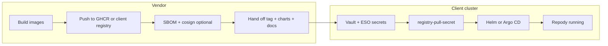
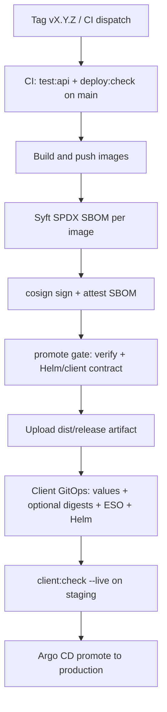

# Cluster and production

Install Repody on the client's **Kubernetes or OpenShift** cluster. Same charts, values merge order, and Ingress path everywhere — OpenShift is just another cluster.

Laptop Compose daily path: [LOCAL.md](./LOCAL.md). Commands: [COMMANDS.md](./COMMANDS.md).

## Contents

1. [One portable path](#one-portable-path)
2. [OpenShift / Kubernetes install](#openshift-kubernetes-install)
3. [Client profiles](#client-profiles)
4. [Secrets and hardening](#secrets-and-hardening)
5. [Vendor → client handoff](#vendor-client-handoff)
6. [Release methodology](#release-methodology)
7. [Observability (cluster)](#observability-cluster)
8. [Production observability baseline](#production-observability-baseline)
9. [Troubleshooting](#troubleshooting)
10. [File reference](#file-reference)

Official references: [Helm on OpenShift](https://docs.openshift.com/container_platform/latest/applications/working_with_helm_charts/installing-a-helm-chart-on-openshift.html) · [Ingress](https://kubernetes.io/docs/concepts/services-networking/ingress/) · [Pod security](https://docs.openshift.com/container-platform/latest/authentication/understanding-and-managing-pod-security-admission.html) · [External Secrets + Vault](https://external-secrets.io/latest/provider/hashicorp-vault/) · [Harbor](https://goharbor.io/docs/latest/install-config/) · [Sigstore cosign](https://docs.sigstore.dev/cosign/overview/) · [Syft](https://github.com/anchore/syft)

---

## One portable path

```
deploy/helm/repody/values.yaml
  → values-common.yaml
  → client values.yaml      (from values-external|bundled.example.yaml)
  → client enterprise.yaml  (from values-enterprise.example.yaml)
```

No OpenShift-only overlay. No chart `Route` CRs. Exposure is always `networking.k8s.io/Ingress` with `ingress.tls.enabled: false` until you add a cert Secret.

Workloads use the same restricted securityContext everywhere (`runAsNonRoot`, no pinned UID) so they fit Kubernetes PSA **restricted** and OpenShift **restricted-v2**.

| Chart | Purpose |
|-------|---------|
| `deploy/helm/repody` | API, web, workers, Ingress |
| `deploy/helm/repody-data` | Postgres, Redis, MinIO (bundled) |
| `deploy/helm/repody-auth` | Optional Keycloak |

Principles:

1. Compose for local daily work — cluster is not required daily.
2. Standard Ingress on every platform.
3. Secrets outside Git for production — Vault → ESO → Kubernetes Secrets.
4. Inference outside the app chart (external VLM).
5. Cluster platform owns NetworkPolicy and egress.
6. Client kit is YAML templates + these docs — not a lab orchestrator.

---

## OpenShift / Kubernetes install

### 1 — Namespace

```bash
kubectl apply -f deploy/client/namespace.example.yaml
```

### 2 — Secrets

Follow [Secrets and hardening](#secrets-and-hardening). Apply ExternalSecrets, wait until Ready, confirm `repody-runtime-secrets` and `registry-pull-secret`.

### 3 — Client values

```bash
cp deploy/client/values-bundled.example.yaml  ~/repody-gitops/values.yaml   # or external
cp deploy/client/values-enterprise.example.yaml ~/repody-gitops/enterprise.yaml
```

Set immutable image tags, Ingress hosts, and OIDC URLs. Keep `ingress.tls.enabled: false` until you have a real TLS Secret.

### 4 — Helm install

```bash
pnpm helm:deps:update
```

**Bundled:**

```bash
helm upgrade --install repody-data deploy/helm/repody-data -n repody --create-namespace \
  -f deploy/helm/repody-data/values.yaml \
  -f deploy/client/bundled/values.data.yaml \
  --wait --timeout 20m

# Optional in-cluster Keycloak:
# helm upgrade --install repody-auth deploy/helm/repody-auth -n repody \
#   -f deploy/helm/repody-auth/values.yaml \
#   -f ~/repody-gitops/values.auth.yaml --wait --timeout 15m

helm upgrade --install repody deploy/helm/repody -n repody \
  -f deploy/helm/repody/values.yaml \
  -f deploy/helm/repody/values-common.yaml \
  -f ~/repody-gitops/values.yaml \
  -f ~/repody-gitops/enterprise.yaml \
  --wait --timeout 25m
```

**External:** omit `repody-data`; use `values-external.example.yaml` for the app chart.

### 5 — Optional GitOps

Use `deploy/client/argocd.application.yaml` (same Application on OpenShift and elsewhere).

### 6 — Verify

```bash
kubectl -n repody get pods,ingress
curl -k https://<api-host>/v1/healthz/live
pnpm client:check
pnpm prod:readiness -- --api-url https://<api-host>
```

### Harbor registry

Pull secret + immutable tags in values. See [deploy/registry/README.md](../deploy/registry/README.md) and `deploy/client/values-harbor.example.yaml`.

### Checklist

- [ ] Namespace with restricted Pod Security
- [ ] Vault + ESO; ExternalSecrets Ready
- [ ] Registry pull secret; immutable image tags
- [ ] Same valueFiles as generic Kubernetes (no OpenShift-only overlay)
- [ ] Ingress hosts; TLS only when you have a shared Secret
- [ ] `/v1/healthz/live` OK

---

## Client profiles

| Profile | When | Values template |
|---------|------|-----------------|
| **External** (default) | Client has managed Postgres, Redis/Valkey, S3 | `deploy/client/values-external.example.yaml` |
| **Bundled** | In-cluster Postgres, Redis, MinIO via `repody-data` | `deploy/client/values-bundled.example.yaml` |

Copy templates to a **private GitOps repo** — never commit real hostnames or secrets.

Networking / egress is owned by the platform team — chart NetworkPolicy stays off by default. Image digests are optional (`helm-images.yaml` from release).

### Web → API (runtime proxy)

The web Deployment sets `INTERNAL_API_URL` / `BACKEND_URL` to `http://<release>-api:8000` at runtime. Next.js proxies browser `/api/v1/*` — the same image works on Compose and Kubernetes.

OIDC: set public `config.oidcIssuer` for browser JWTs; set `config.oidcJwksUrl` (and optionally `config.oidcInternalIssuer`) to in-cluster Keycloak Service DNS. Helm derives `AUTH_KEYCLOAK_INTERNAL_ISSUER` from `oidcJwksUrl` when `oidcInternalIssuer` is empty.

Inference URLs (`llamacppBaseUrl`, `paddleocrV6BaseUrl`, `qwen35BaseUrl`) must be cluster-reachable — never `host.docker.internal`.

### Edge (portable Ingress)

```yaml
ingress:
  enabled: true
  host: app.client.example.com
  apiHost: api.client.example.com
  filesHost: files.client.example.com   # bundled profile
  tls:
    enabled: false
    secretName: repody-tls
```

Workloads are standard `apps/v1` Deployment + `v1` Service.

### Preflight

```bash
pnpm client:check
pnpm deploy:check
```

```bash
pnpm enterprise:secrets -- \
  --values deploy/helm/repody/values-common.yaml \
  --values deploy/client/values-external.example.yaml \
  --values deploy/client/values-images.example.yaml \
  --values deploy/client/values-enterprise.example.yaml \
  --external-secret deploy/client/secrets/runtime.externalsecret.example.yaml
```

(Bundled: swap `values-bundled.example.yaml` and `runtime-bundled.externalsecret.example.yaml`.)

### External profile (BYO services)

Client runs **only** the `repody` chart.

```bash
kubectl apply -f deploy/client/namespace.example.yaml
kubectl apply -f deploy/managed/external-secrets/vault-clustersecretstore.example.yaml
kubectl apply -f deploy/client/secrets/registry-pull.externalsecret.example.yaml
kubectl apply -f deploy/client/secrets/runtime.externalsecret.example.yaml
kubectl -n repody wait externalsecret --all --for=condition=Ready --timeout=5m
```

```bash
cp deploy/client/values-external.example.yaml ~/repody-gitops/values.yaml
cp deploy/client/values-enterprise.example.yaml ~/repody-gitops/enterprise.yaml

pnpm helm:deps:update
helm upgrade --install repody deploy/helm/repody -n repody --create-namespace \
  -f deploy/helm/repody/values.yaml \
  -f deploy/helm/repody/values-common.yaml \
  -f ~/repody-gitops/values.yaml \
  -f ~/repody-gitops/enterprise.yaml \
  --wait --timeout 25m
```

From a worker pod, confirm VLM reachability ([EXTRACTION.md](./EXTRACTION.md#nuextract-repodyvlm)).

### Bundled profile (in-cluster data plane)

| | Bundled | External |
|--|---------|----------|
| Data plane | `repody-data` chart | Client RDS / ElastiCache / S3 |
| Job queue | Taskiq over in-cluster Redis | Client Redis / Valkey |
| Secrets | Vault → ESO | Vault → ESO |
| Charts | `repody-data` + `repody` | `repody` only |

**IdP:** bundled does **not** include Keycloak by default — set `config.oidcIssuer` to the organization's IdP. Optional: `repody-auth` for lab/small tenants.

Apply ExternalSecrets: `registry-pull`, `data-plane`, `runtime-bundled`. Ensure Vault `AUDIT_REDIS_URL` targets the Redis service from `repody-data` (e.g. `redis://repody-data-redis-master.repody.svc:6379`).

Install order: `repody-data` then `repody` (see [Helm install](#4-helm-install) above).

### Argo CD

Example: `deploy/client/argocd.application.yaml`. **Bundled:** sync `repody-data` before `repody`.

### Production hardening

Always merge `values-enterprise.example.yaml`:

- `platform.compatibility.restricted` — non-root, drop `ALL` capabilities
- `secrets.create: false`
- `networkPolicy.enabled: false` by default — platform team owns NetworkPolicy / egress
- PodDisruptionBudgets and autoscaling on API / web / workers

---

## Secrets and hardening

Production **never** stores passwords, API keys, or connection strings in Helm values or Git. Use **External Secrets Operator** (or Sealed Secrets / SOPS) backed by **Vault** or equivalent.

Manifests: `deploy/client/secrets/` · ClusterSecretStore: `deploy/managed/external-secrets/`

### Required Kubernetes secrets

| Secret | Profile | Created by |
|--------|---------|------------|
| `registry-pull-secret` | both | ESO or manual bootstrap |
| `repody-runtime-secrets` | both | ESO — `runtime` or `runtime-bundled` |
| `repody-data-postgresql` | bundled | ESO — `data-plane` |
| `repody-data-redis` | bundled | ESO |
| `repody-data-minio` | bundled | ESO |

### Vault layout (example)

```
secret/repody/production/
  AUTH_SECRET
  AUTH_KEYCLOAK_CLIENT_SECRET
  KEYCLOAK_ADMIN_PASSWORD       # only if using in-cluster repody-auth
  AUDIT_DATABASE_URL
  AUDIT_REDIS_URL               # required for Taskiq
  AUDIT_MINIO_ACCESS_KEY
  AUDIT_MINIO_SECRET_KEY
  BUGSINK_DSN
  AUDIT_LLAMACPP_API_KEY
  AUDIT_OPERATOR_BENCHMARK_PASSWORD  # optional; never ConfigMap / Helm config.*
  REGISTRY_DOCKERCONFIGJSON

secret/repody/production/data/   # bundled data-plane only
  POSTGRES_ADMIN_PASSWORD
  POSTGRES_USER_PASSWORD
  REDIS_PASSWORD
  MINIO_ROOT_USER
  MINIO_ROOT_PASSWORD
```

### Apply order

```bash
kubectl apply -f deploy/client/namespace.example.yaml
kubectl apply -f deploy/managed/external-secrets/vault-clustersecretstore.example.yaml
kubectl apply -f deploy/client/secrets/registry-pull.externalsecret.example.yaml
kubectl apply -f deploy/client/secrets/runtime.externalsecret.example.yaml
# bundled only:
kubectl apply -f deploy/client/secrets/data-plane.externalsecret.example.yaml
kubectl -n repody wait externalsecret --all --for=condition=Ready --timeout=5m
```

**OpenShift internal registry:** store pull credentials for both the external route and `image-registry.openshift-image-registry.svc:5000/...` in `REGISTRY_DOCKERCONFIGJSON`.

### What stays out of Git

Database passwords, Redis auth, MinIO keys, `AUTH_SECRET`, OIDC client secrets, VLM API keys, Bugsink DSN, registry pull tokens. Only **references** (`existingSecret`, Vault `remoteRef`) belong in values.

### On-prem managed Postgres (CloudNativePG)

Examples live under `deploy/managed/cloudnativepg/` (Cluster, Pooler, ScheduledBackup). Install the operator, apply secrets, then point `AUDIT_DATABASE_URL` at the pooler service (e.g. `postgresql+asyncpg://…@repody-postgres-pooler-rw.repody-data.svc:5432/repody`). Overlay examples: `deploy/helm/repody/values-production.onprem-managed.yaml.example`. Redis/Valkey and object storage stay outside the app chart.

---

## Vendor → client handoff



| Role | Responsibility |
|------|----------------|
| **Vendor** | Build, push to GHCR or client registry, publish Helm charts, document tag |
| **Client** | Registry pull secret, Vault secrets, values in private GitOps, Helm/Argo |

### Vendor: push images

| Option | When | Example base |
|--------|------|--------------|
| **Harbor** | On-prem / OpenShift clients | `harbor.example.com/repody` |
| **GHCR** | GitHub-hosted releases | `ghcr.io/yourorg/repody` |
| **Other OCI** | ACR, ECR, GCR | `registry.example.com/repody` |

```powershell
$env:REPODY_IMAGE_REGISTRY="ghcr.io/yourorg/repody"
$env:REPODY_IMAGE_TAG="1.0.0"
docker login ghcr.io -u <github-user>
pnpm images:release
```

Pushes `…/repody-backend:1.0.0` and `…/repody-web:1.0.0`. Implementation: [`deploy/scripts/build-images.mjs`](../deploy/scripts/build-images.mjs). Tag workflow: [images-ghcr.yml](../.github/workflows/images-ghcr.yml).

Docker Hub multi-arch (portable Mac + Intel):

```powershell
$env:REPODY_IMAGE_REGISTRY="mehdigououiad"
$env:REPODY_IMAGE_TAG="0.1.0"
$env:REPODY_IMAGE_PLATFORMS="linux/amd64,linux/arm64"
$env:REPODY_BACKEND_EXTRAS="otel"
pnpm images:release
```

Supply chain: `pnpm release:attest` · `pnpm release:promote -- --channel=staging` (see [Release](#release-methodology)).

**Hand off:** registry host + project, immutable tag, pull credentials, Helm charts (`deploy/helm/repody`, `repody-data`, `repody-auth`), values templates, this guide.

**Mac laptop (no source):** `pnpm client:pack:mac` → zip under `dist/` — [LOCAL.md — Mac runtime](./LOCAL.md#mac-runtime-no-source). Do not hand the monorepo.

### Client: pull and deploy

1. `pnpm client:check` · `pnpm deploy:check`
2. Namespace + Vault/ESO
3. Store `REGISTRY_DOCKERCONFIGJSON` in Vault; apply ExternalSecrets
4. Copy profile template to private GitOps; set `CHANGE_ME_*`, `config.llamacppBaseUrl`, `config.oidcIssuer`
5. Helm install (bundled or external) + enterprise overlay
6. Verify health + `pnpm prod:readiness`

---

## Release methodology

Ship with **immutable images**, **SPDX SBOMs**, **cosign signatures**, and a **promotion gate**.

| Lane | Registry | Signing | When |
|------|----------|---------|------|
| **GitHub release** | GHCR | cosign keyless (OIDC) | Tag `v*` or workflow dispatch |
| **On-prem / client registry** | `registry.example.com/repody` | `COSIGN_KEY` | Customer-facing registry |
| **Air-gap** | Client import | SHA256 bundle + optional cosign pubkey | Disconnected sites |



**GitHub:** `git tag v1.2.3 && git push origin v1.2.3` → workflow builds, attests, promotes staging, uploads `dist/release/<tag>/`.

**Manual:**

```powershell
$env:REPODY_IMAGE_REGISTRY="registry.example.com/repody"
$env:REPODY_IMAGE_TAG="1.2.3"
pnpm images:release
pnpm release:attest
pnpm release:promote -- --channel=staging
# or: pnpm release:all
```

On-prem: set `COSIGN_KEY` / `COSIGN_PASSWORD` / `COSIGN_PUBLIC_KEY`. Verify: `pnpm release:verify`.

Promotion artifact: `release-manifest.json`, `helm-images.yaml`, `sbom/*.spdx.json`, `SHA256SUMS`.

| Command | Role |
|---------|------|
| `pnpm images:build` | Local images only |
| `pnpm images:release` | Build + push |
| `pnpm release:attest` | SBOM + cosign |
| `pnpm release:verify` | Verify signatures |
| `pnpm release:promote` | Verify + client contract + manifest |
| `pnpm release:all` | push + attest + promote |

---

## Observability (cluster)

Use upstream Helm charts — no hand-maintained observability YAML in this repo.

```yaml
observability:
  otelEnabled: true
  otelEndpoint: http://otel-collector.observability.svc.cluster.local:4318/v1/traces
```

Install collector per [OpenTelemetry Helm charts](https://github.com/open-telemetry/opentelemetry-helm-charts/tree/main/charts/opentelemetry-collector).

Recommended stacks: Grafana k8s monitoring · kube-prometheus-stack · Loki stack.

Clients own their observability backend. Repody emits JSON logs (`config.logJson: true`) and optional OTLP traces. Set `observability.bugsinkDsn` (or Vault `BUGSINK_DSN`) for error tracking. Laptop Compose + Bugsink: [LOCAL.md](./LOCAL.md#sign-in-and-verify).

---

## Production observability baseline

Minimum signals and connection budgeting. Clients own Prometheus/Grafana/Loki.

### Timeout alignment (extract)

| Helm key | Env var | Starting value | Rule |
|----------|---------|----------------|------|
| `workerTaskTimeoutMinutes` | `AUDIT_WORKER_TASK_TIMEOUT_MINUTES` | 3 | Taskiq + `process_run` ceiling (**hard max 3**) |
| `repodyVlmTimeoutSeconds` | `AUDIT_REPODY_VLM_TIMEOUT_SECONDS` | 180 | VLM HTTP ≤ worker seconds |
| `staleRunTimeoutMinutes` | `AUDIT_STALE_RUN_TIMEOUT_MINUTES` | 5 | Reap `running` |
| `queuedStaleTimeoutMinutes` | `AUDIT_QUEUED_STALE_TIMEOUT_MINUTES` | 60 | Reap `queued` when no workers |
| `workerExtract.terminationGracePeriodSeconds` | — | 240 | ≥ worker task timeout (seconds) |

**Rule:** `repodyVlmTimeoutSeconds` ≤ `workerTaskTimeoutMinutes` × 60; `staleRunTimeoutMinutes` ≥ worker timeout + one maintenance interval.

### Connection pool budget

Defaults: `dbPoolSize: 5`, `dbMaxOverflow: 10`, `redisMaxConnections: 20`.

```
Postgres ≈ (api + extract + fast replicas) × (dbPoolSize + dbMaxOverflow)
Redis ≈ (api + extract + fast) × redisMaxConnections
```

Example: 2+2+2 → up to 90 Postgres connections at peak overflow.

### Readiness and health

- **`GET /v1/healthz/live`** — liveness
- **`GET /v1/healthz`** — readiness: Postgres + Redis PING (503 when `redisOk: false`)

### Log-based alerts (pilot)

| Alert | Log / field | Threshold |
|-------|-------------|-----------|
| Run failures | `run_failed`, `run_failed_terminal` | >5% of runs / 15m |
| Stuck runs reaped | `stale_run_reaped` | any in prod |
| Dispatch failure | `taskiq_dispatch_failed_terminal`, outbox `failed` | any |
| Queue pressure | readiness `queuedRuns` / admission cap | >80% sustained 10m |
| VLM slow | `run_metadata.extractionMs` | p99 > 80% of worker timeout |
| Worker unhealthy | `worker-extract` restart loop | >3 restarts / 15m |

`GET /v1/dashboard` / `GET /v1/metrics` for business KPIs. **Not included today:** Prometheus `/metrics` scrape — use OTLP + log alerts.

```powershell
kubectl -n repody logs -l app.kubernetes.io/component=control --tail=300 --timestamps
kubectl -n repody logs -f deploy/repody-worker-extract
```

```bash
pnpm prod:readiness -- --api-url https://api.staging.example.com
pnpm extract:soak -- --api-url https://api.staging.example.com --token $TOKEN --concurrency 8 --duration-minutes 30
```

---

## Troubleshooting

| Symptom | Check |
|---------|-------|
| API stuck in init | `AUDIT_REDIS_URL` in runtime secret; worker pods running |
| Workers cannot extract | Reach `config.llamacppBaseUrl` ([EXTRACTION.md](./EXTRACTION.md)) |
| 401 from inference | `AUDIT_LLAMACPP_API_KEY` in runtime secret |
| Upload failures | `filesHost` / public object-storage endpoint |
| Auth failures | OIDC issuer and JWKS reachable from API pods |
| `ImagePullBackOff` | `registry-pull-secret`; auth host must match image registry host |
| `no basic auth credentials` | ESO not synced — `kubectl describe externalsecret -n repody` |
| Wrong image path | Registry = `host/project`; repository = `{registry}/repody-backend` |
| API crash `Invalid endpoint: http://` | Set `externalObjectStorage.endpoint` |
| DB `relation does not exist` | Enable `migrations.enabled: true` or run migrations job |
| Run stuck `running` | Extract worker logs; VLM; stale reap |
| Run stuck `queued` | Redis; outbox; admission 503; worker replicas |
| SSE silent | Redis; `redisOk` on healthz |
| `syft not found` / cosign fail | Install tools or run attest in CI; on-prem use `COSIGN_KEY` |

---

## File reference

| File | Purpose |
|------|---------|
| `deploy/client/values-external.example.yaml` | BYO Postgres / Redis / S3 |
| `deploy/client/values-bundled.example.yaml` | In-cluster data plane |
| `deploy/client/values-enterprise.example.yaml` | Hardening overlay |
| `deploy/client/bundled/values.data.yaml` | `repody-data` overlay |
| `deploy/client/secrets/` | ExternalSecret examples |
| `deploy/client/namespace.example.yaml` | Namespace + PSA labels |
| `deploy/client/argocd.application.yaml` | Argo CD Application skeleton |
| `deploy/scripts/build-images.mjs` | Vendor image build/push |
| `deploy/scripts/release-supply-chain.mjs` | SBOM, cosign, promotion |
| `deploy/registry/README.md` | Hub / GHCR / Harbor |
| `deploy/ENV.md` | Runtime env keys |
