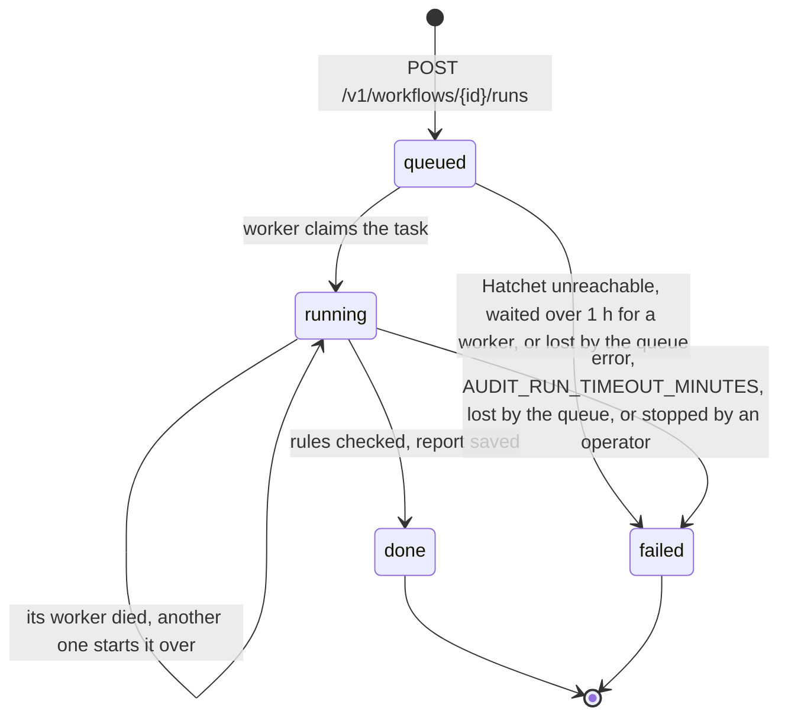
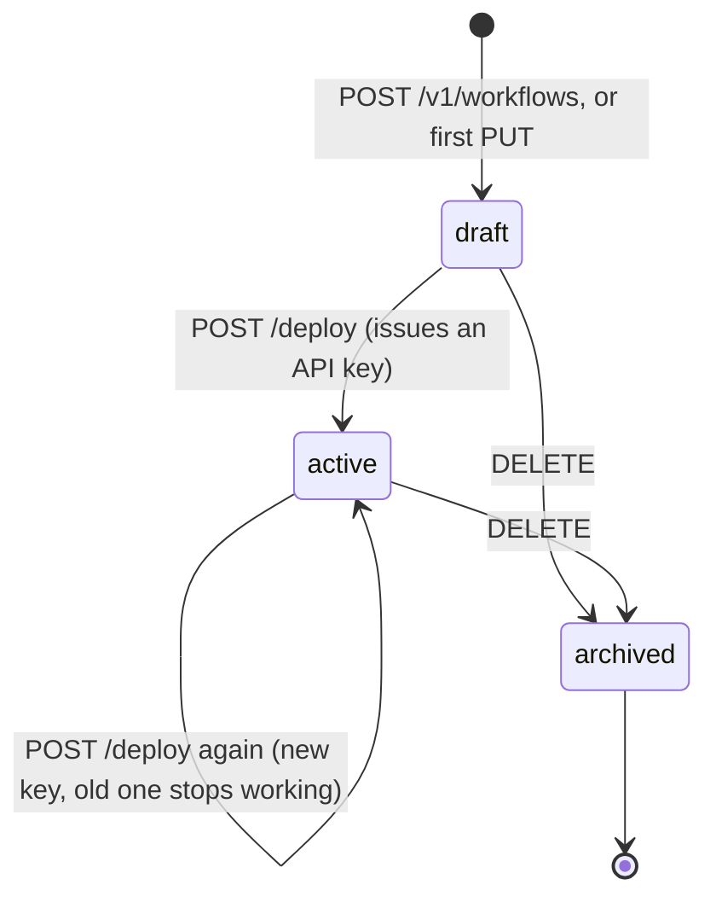
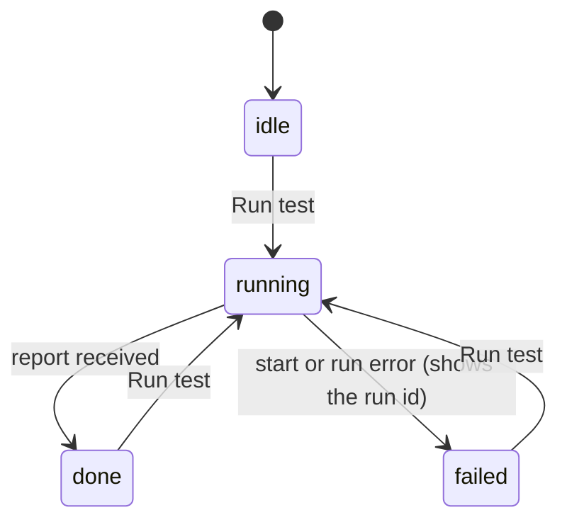
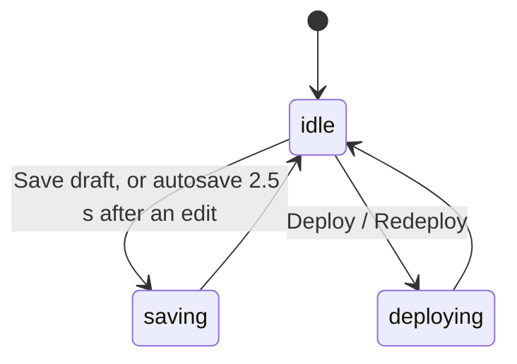

# Lifecycles

Every status in Repody is a small state machine with one owner. This page lists them, their
transitions, and the code allowed to change each one. Decision: [ADR 010](./adr/010-explicit-lifecycles.md).

**Rule of thumb:** a status changes only through the code named under "Owner". The backend owns
the persisted states, enforces them with a transition table and Postgres CHECK constraints, and
publishes them as enums in the OpenAPI schema (`lib/api/generated/schema.d.ts`). The frontend
holds each async flow as one discriminated union, so a contradictory state cannot be built.

| State machine | States | Owner | Enforced by |
|---|---|---|---|
| [Run](#run) | queued · running · done · failed | `backend/src/repody/app/lifecycle.py` (`move_run`) | `RUN_TRANSITIONS`, `ck_runs_status`, `ck_runs_outcome` |
| [Workflow](#workflow) | draft · active · archived | `backend/src/repody/app/workflows.py` (`deploy_workflow`, `archive_workflows`) | `ck_workflows_status`; not writable by clients |
| [Rule result](#rule-result) | passed · failed · skipped | `backend/src/repody/rules/evaluate.py` | `ck_rule_results_status` |
| [Run progress step](#run-progress-step) | pending · active · done | `backend/src/repody/app/progress.py` (`Tracker`) | `ProgressStep.status` enum |
| [Builder test run](#builder-test-run) | idle · running · done · failed | `lib/api/runs.ts` (`RunView`) | TypeScript union |
| [Builder sync](#builder-sync) | idle · saving · deploying | `components/workflow/builder/use-builder-workflow.ts` (`BuilderSync`) | TypeScript union |

## Run

- `done` and `failed` are final. `outcome` (passed · warning · failed) exists only on a done run;
  an **audit** is a done run, so the audit list filters by outcome, never by run status.
- Each transition is one conditional `UPDATE … WHERE status IN (<allowed sources>)`. When two
  processes race on a run (a duplicate task delivery, Hatchet's failure task and a slow worker), the loser's
  update matches no row and it backs off: a final state is never overwritten.
- Hatchet bounds each run (repody/worker.py): it fails a run that waits an hour for a worker
  or runs past `AUDIT_RUN_TIMEOUT_MINUTES` through the workflow's failure task
  (`execute.fail_unfinished`). A run Hatchet could not take is failed when it is started.
- A worker that stops heartbeating (a crash, an out-of-memory kill, a deploy's grace period
  running out) loses its tasks to another worker ([Hatchet FAQ](https://docs.hatchet.run/v1/faq)).
  The new delivery finds the run still `running` and starts it over (`execute._claim`); nothing
  but its progress was saved by the lost attempt. Only within `AUDIT_RUN_TIMEOUT_MINUTES` of its
  first start: after that the run fails, so a document that kills its worker every time (out of
  memory) cannot restart for ever.
- When the database cannot be reached while a run is processed (Postgres restarting), the run is
  not failed: Hatchet retries its task after 3, 9 and 27 s, and the retry starts it over. Its
  progress, display only, is skipped while the database is away.
- Runs Hatchet will never report on fail on the maintenance cron (`lifecycle.fail_stuck`): queued
  for over an hour and 10 minutes (the API stopped between saving the run and queueing it), or
  running for twice `AUDIT_RUN_TIMEOUT_MINUTES` and 10 minutes since its first start (one
  re-delivery just inside the limit gets one more full attempt). Like every failure, such a run pays
  nothing when it never started.
- Clients poll it as `RunState.status` (`GET /v1/runs/{id}`) until it is `done` or `failed`
  (`lib/api/runs.ts` `useRun`). The server owns the timeout, so polling always ends.

## Workflow

- The server owns the status. `PUT /v1/workflows/{id}` saves the definition and never changes the
  status (a `status` field in the body is ignored); saving an archived workflow is a 404.
- **Active means deployed**: `status = 'active'` exactly when `deployed_at` is set (CHECK
  constraint). Production API runs need it (`409 Workflow is not deployed` otherwise).
- Archived workflows are hidden from every read (`404`); their runs and audits stay.

## Rule result

Set once per rule when a run finishes (`rules/evaluate.py` `evaluate_rule`):
`failed` when a condition does not hold, `skipped` when a value it needs was not extracted or a
field is unknown, `passed` otherwise. A run's `outcome` follows (`execute.run_outcome`): any failed
`reject` rule → failed; any other failed rule, a skipped `reject` rule (its check did not happen),
a document that could not be read, no field read at all, or a field a second read did not confirm
(or a second read that failed, `ExtractionMeta.second_read`) → warning; else passed. A skipped `flag`
rule changes nothing.

## Run progress step

The step plan stored on a run (`runs.progress`), read with the run: queued → extract each document
(concurrently) → check the rules → save the report. Each step has a `kind` and data (document type,
rule count, fields extracted, `failed`); clients word it in their language. `Tracker.start(id)` makes
a step active (and the queue step done), `Tracker.finish(id, …)` marks it done, `Tracker.complete()`
marks all done. It is display only: the run's status is the source of truth.

## Builder test run

A test run is the run id of its last start (`TestSession.runId`); `useRun` polls it and returns only
the data of its phase (`progress` while running, `result` when done, `error` when failed). The chosen
test files live beside it and survive runs.

## Builder sync

One request to the server at a time: Save, Deploy and Redeploy are disabled outside `idle`, and
autosave waits for `idle`. A double click therefore never issues two API keys, and a deploy never
races a save.

## Adding or changing a state

1. Backend: add it to the `Literal` in `schemas/` and, for runs, to `RUN_TRANSITIONS`; change
   it only through the owner above.
2. Write an Alembic migration that moves existing rows and updates the CHECK constraint (and the
   matching `CheckConstraint` in `infra/models.py`).
3. `pnpm codegen:api`, then let `pnpm typecheck` show every `Record<Status, …>` and union that
   needs the new case.
4. Update this page and the tests in `backend/tests/integration/test_lifecycle.py`.
